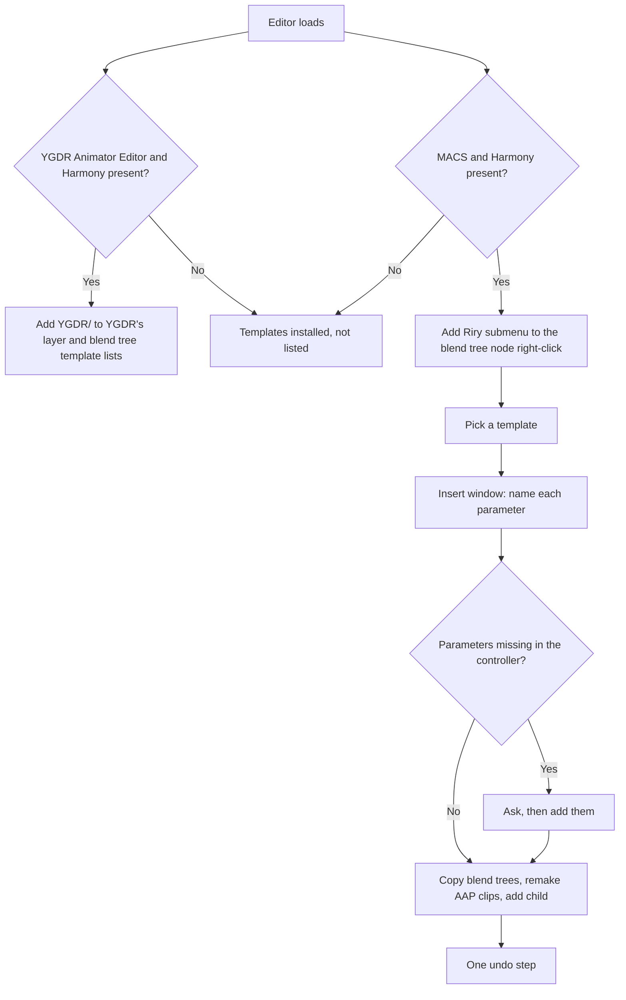

# Animator Presets

## 1. Where to find it

| Access | Location | Item |
| --- | --- | --- |
| Animator window (YGDR) | Layer **+** menu | Riry layer templates |
| Animator window (YGDR) | Blend tree **Import Template** list | Riry blend tree templates |
| Right Click (Animator blend tree node, MACS) | **Riry** submenu beneath **New** | Riry blend tree templates |

## 2. Brief description

A separate package (`com.riry.animatortemplates`) of animator templates for YGDR Animator Editor and MACS, with the editor code that lists them in those tools' menus.

## 3. What the tool can be used for

- Adding ready-made animator layers and blend trees to a controller from YGDR Animator Editor's and MACS's own menus.

## 4. How the tool behaves

**YGDR (`YGDR/`)**
- Layer templates (animator controllers) appear in the Animator window's layer **+** menu among YGDR's own templates; blend tree templates appear in the blend tree **Import Template** list.
- A `.` in a template's name makes a submenu: `Riry.Toggle.Simple` shows as **Riry > Toggle > Simple**.
- YGDR Animator Editor only looks in its own package and in `Assets/YGDR Animator/User Templates`, so `YgdrTemplateBridge` adds this package's folder to its template lists.
- YGDR's **Delete Template** would delete a template's whole folder; for this package's templates the bridge refuses and logs an error.

**MACS (`MACS/`)**
- Right-clicking a blend tree node in the Animator window shows the templates in a **Riry** submenu beneath MACS's **New**; a subfolder makes a submenu.
- Choosing one opens a window to insert it into the clicked blend tree. Each parameter the template uses gets a row: type a name, or pick one from MACS's fuzzy list of the controller's parameters.
- **Insert** asks before adding parameters the controller does not have. The template's AAP clips are made again for the chosen names with MACS's AAP clip generator (`AAP {parameter} {value}` in the controller's `Animations` folder; an existing one is reused).
- One Ctrl+Z removes everything the insert added to the controller: the parameters, the copied blend trees and the new child. AAP clips are kept.
- If MACS's internal AAP generator or fuzzy list are not found, the package's own copy of the same behaviour is used and a warning says so once per session.

**Both**
- Need the VRChat SDK (which brings Harmony) and the tool they extend. Without them the templates still install but are not in those menus. If an update stops a patch working, a warning says so once per session.

## 5. Flow chart

## 6. References

- YGDR Animator Editor (https://github.com/YerGodDamnRight/YGDR-Animator-Editor): its template lists, patched by `YgdrTemplateBridge.cs` (GPL-3.0 or later).
- MACS: its blend tree **New** menu, AAP clip generator and fuzzy parameter list.
- Harmony (shipped with the VRChat SDK) for the patches.
