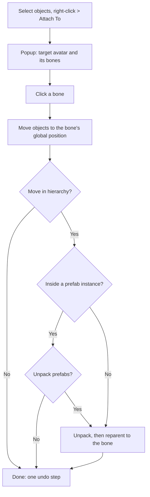

# Attach To

## 1. Where to find it

| Access | Location | Item |
| --- | --- | --- |
| Right Click (hierarchy) | RiryTools > Attach To | |

## 2. Brief description

Moves the selected objects to one of an avatar's bones and can reparent them to it.

## 3. What the tool can be used for

- Placing accessories, props or clothing objects on an avatar bone (for example a hat on the Head bone) without moving them by hand.

## 4. How the tool behaves

- Opened from the Hierarchy's right-click **RiryTools > Attach To** with objects selected.
- The popup shows the target avatar, a button for each listed bone the avatar has, and **Add bone** to list more bones (saved per user).
- Clicking a bone moves the selected top-level objects to the bone's global position; rotation and scale are left alone.
- It then asks **Move in hierarchy?**; Yes reparents them to the bone, keeping their global position, rotation and scale.
- An object inside a prefab instance is only unpacked after the **Unpack prefabs?** warning. An object that is the bone or one of its parents is left out.
- The whole action is one undo step.

## 5. Flow chart

## 6. References

- Unity's `HumanBodyBones` for finding the avatar's bones.
