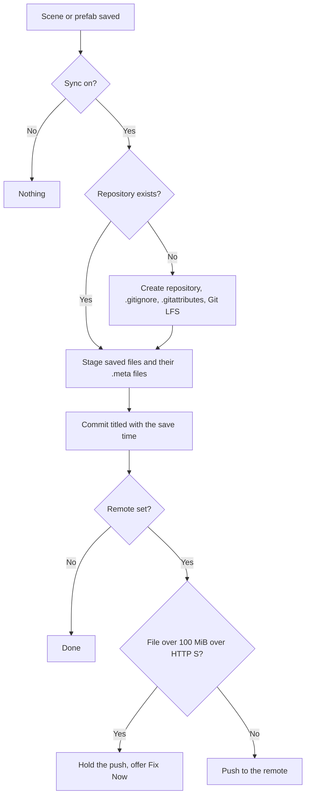

# AutoSync

## 1. Where to find it

| Access | Location | Item |
| --- | --- | --- |
| Menu bar | RiryTools > AutoSync > Sync / Configuration | |
| Menu bar | Git > Sync / Configuration | |
| Main Menu | AutoSync | Sync, Configuration |

## 2. Brief description

Commits every scene or prefab save to the checked-out Git branch and pushes it to the chosen remote.

## 3. What the tool can be used for

- Keeping a running Git history of scene and prefab saves, so a broken scene or prefab can be recovered from an earlier save.
- Backing the project up to a Git server as you work.

## 4. How the tool behaves

- Off until turned on, per user and per project (**Tools > RiryTools > AutoSync > Sync**).
- Without a repository, one is created in the project folder with the Unity `.gitignore` and `.gitattributes`, and Git LFS is enabled.
- On each scene or prefab save, only the saved files and their `.meta` files are committed, titled with the time of the save.
- When a remote is set, every commit is pushed to it. Git's credential manager handles sign-in.
- **Configuration** sets the branch, remote, `.gitignore` and `.gitattributes`, shows whether the server has Git LFS, and lists tracked files over 100 MiB so they can be ignored; a save that would push such a file over HTTP(S) holds the push and offers **Fix Now**.
- Without Git installed, it links to the download.

## 5. Flow chart

## 6. References

- Git and Git LFS (command line), Unity's standard `.gitignore` and `.gitattributes`.
