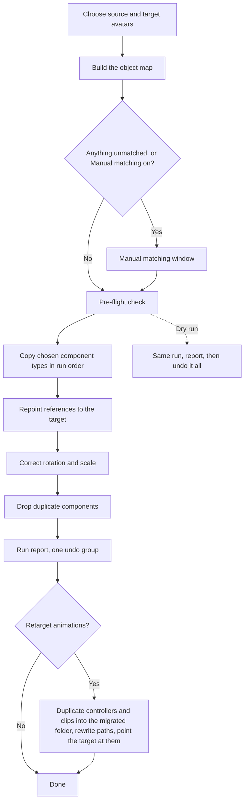

# Avatar Migration Assistant

## 1. Where to find it

| Access | Location | Item |
| --- | --- | --- |
| Menu bar | RiryTools > Avatar Migration Assistant | |
| Main Menu | Tools | Avatar Migration Assistant |

## 2. Brief description

Copies components and settings from an old avatar (source) to a new one (target), and can retarget the new avatar's animations.

## 3. What the tool can be used for

- Moving an avatar's setup (PhysBones, contacts, constraints, VRCFury and other components) onto a new version of the same avatar.
- Keeping the avatar's animations working after the new version's hierarchy changed.

## 4. How the tool behaves

- Objects are matched between the two avatars (the object map). Anything left unmatched, or everything when **Manual matching** is on, is shown in the Manual matching window first.
- A pre-flight check lists what the run will do.
- The run copies the chosen component types in a fixed order, repoints references to the target's objects, corrects rotation and scale, and drops duplicates of components the target already had. Each step is guarded, so one failure is logged and the rest continues. The whole run is one undo group, and a report window lists the results.
- **Dry run** does the same run, lists what it copied, repointed and left out in the report, then undoes all of it, so the target is left as it was.
- **Retarget animations** duplicates the target's controllers and the clips they use into a migrated folder, rewrites the clips' paths for the new hierarchy through the object map, points the duplicated controllers at the duplicated clips, and points the target at the duplicates.
- The source avatar and the original files are never changed.
- Without the VRChat SDK it still runs, with the VRChat parts left out.

## 5. Flow chart

## 6. References

- VRChat SDK component types, VRCFury (read by type name).
