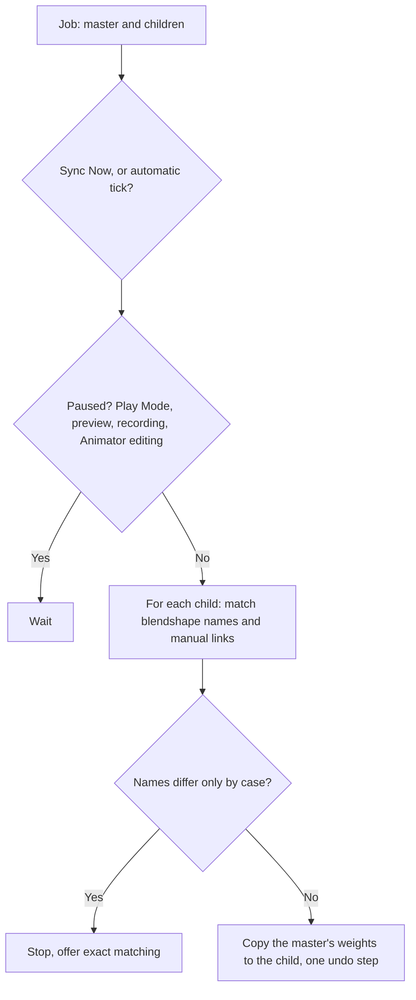

# Blendshape Sync

## 1. Brief description

Copies the blendshape weights of a master mesh to child meshes that have blendshapes of the same name.

## 2. What the tool can be used for

- Keeping the blendshape weights of clothing, hair or accessories in step with a body mesh while you work.

## 3. How the tool behaves

- Each job is a master SkinnedMeshRenderer and its children, with a name (by default the master and its child count).
- **Sync Now** copies every matching weight once; **Run automatically** syncs every half second.
- Names match ignoring case. If two blendshapes on a child differ only by case, the pass stops and offers exact matching; **Case-sensitive** switches it by hand.
- **Manual link** maps a master blendshape to a differently named child blendshape.
- Ctrl+Z undoes a sync and stops automatic syncing. **Set All to Original** puts every weight back as it was when its renderer was assigned.
- Syncing pauses during Play Mode, animation preview or recording, and Animator graph editing.
- Jobs keep running after their window closes, are listed in the Main Menu's Blendshape Sync tab, and are saved per scene for this user.
- Only renderer weights change; meshes and animation clips are never changed.

## 4. Flow chart

## 5. References

- Unity's SkinnedMeshRenderer blendshape API.
