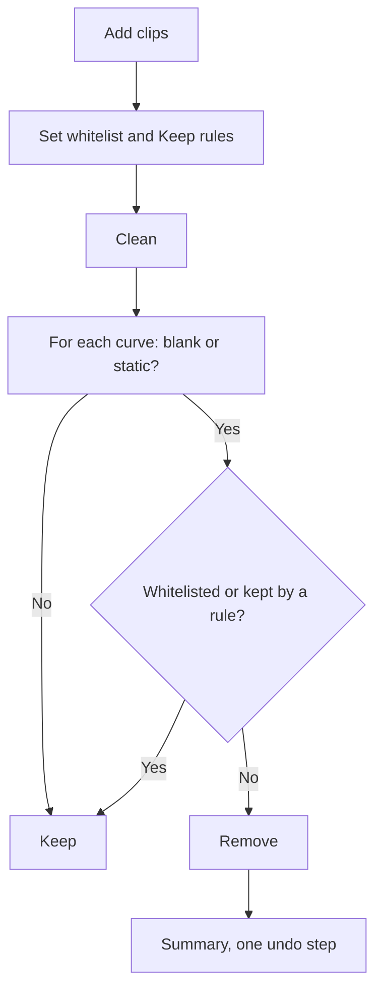

# Clean Animation Keys

## 1. Where to find it

| Access | Location | Item |
| --- | --- | --- |
| Menu bar | RiryTools > Animator Tools > Clean Animation Keys | |
| Main Menu | Animator Tools | Clean Animation Keys |
| Right Click (project) | RiryTools > Animator Tools > Clean Animation Keys | |
| Animation window | Clean Keys | |

## 2. Brief description

Removes blank blendshape curves and static bone transform curves from animation clips.

## 3. What the tool can be used for

- Cleaning animations from exporters that key every bone and shapekey, so the clips only animate what actually changes.

## 4. How the tool behaves

- Opened from the Project window's right-click **RiryTools > Animator Tools > Clean Animation Keys** with clips selected, from **Tools > RiryTools > Animator Tools**, from the Main Menu's Animator Tools tab, or with **Clean Keys** in the Animation window.
- The window opens against the left edge of Unity's main window.
- A name **Whitelist** and four **Keep** rules decide what stays; the per-animation **Whitelist** lists only keys that would be removed.
- **Clean** removes the rest and shows how many curves were removed. One undo step restores every animation.
- Extract Animations uses the same cleaning, with its own options.

## 5. Flow chart

## 6. References

- Unity's `AnimationUtility` curve API.
