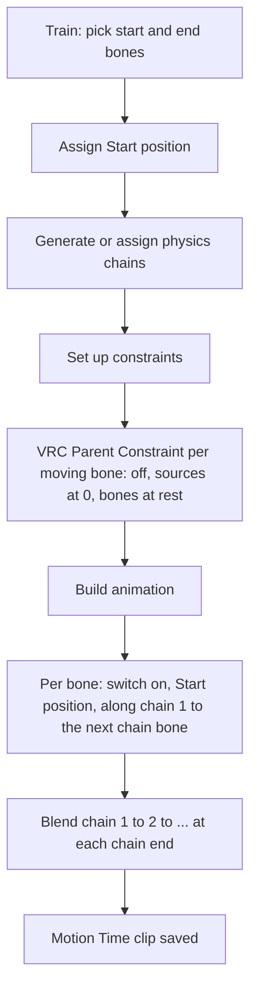

# Constraint Tools

## 1. Where to find it

| Access | Location | Item |
| --- | --- | --- |
| Menu bar | RiryTools > Constraint Tools | |
| Main Menu | Tools > Constraint Tools | Train, Bezier, Insertable prop, Dual axis detector, Three axis detector |
| Right Click (hierarchy) | RiryTools > Constraint Tools > Train | |
| Right Click (hierarchy) | RiryTools > Constraint Tools > Bezier | |
| Right Click (hierarchy) | RiryTools > Constraint Tools > Insertable prop | |
| Right Click (hierarchy) | RiryTools > Constraint Tools > Dual axis detector | |
| Right Click (hierarchy) | RiryTools > Constraint Tools > Three axis detector | |

## 2. Brief description

One window with a tab per subtool, all built on VRChat constraints and contacts: Train, Bezier, Insertable prop, Dual axis detector and Three axis detector.

## 3. What the tool can be used for

- **Train:** animating a bone chain (a tail, ears, hair) so it slides onto physics-driven copies of itself, one bone after another, driven by a single float.
- **Bezier:** bending a bone chain along a curve by moving two handles.
- **Insertable prop:** a prop that can be drawn from, dropped from and put back into a socket (a dagger and sheath, for example).
- **Dual axis detector / Three axis detector:** reading how far a bone tilts left/right and up/down relative to a plane, as contact parameters.

## 4. How the tool behaves

**Train**
- Opened from the Hierarchy's right-click **RiryTools > Constraint Tools > Train** on the first bone (Ctrl/Cmd-click the end bone too), or the Main Menu's Tools > Constraint Tools sub-tab.
- The real chain runs from the start bone to the end bone. The end bone is where the train stops; the bones before it are constrained.
- One **Start position** object is where every bone sits before the train reaches it.
- 1 to 5 physics chains (`Phys1_`, `Phys2_`...) can be generated beside the chain, each matching the real chain bone for bone.
- **Set up constraints** adds a VRC Parent Constraint to each moving bone, switched off, with every source at 0, at-rest values from the bone's pose, and the bones left at rest. One undo step.
- **Build animation** writes a Motion Time clip: each bone is switched on, moves from the Start position along physics chain 1 one bone per step (the tip leads, each bone toward the root one step later) and stops one chain bone past its own, so the last stops at the end bone's chain bone; then every bone blends to chain 2, chain 3 and so on. Train end, chain ends and two curves shape the timing.
- On a prefab instance, the changes can be saved as overrides, or to a `<name>_ROOT.prefab` variant for an FBX.

**Bezier**
- Rigs a bone chain to one cubic Bezier curve (two anchors, two handles) so moving the handles bends the chain, with optional twist and stretch.

**Insertable prop**
- Opened from the Hierarchy's right-click **RiryTools > Constraint Tools > Insertable prop** on the socket, which fills Socket and the avatar it is in as Avatar root, or the Main Menu's Tools > Constraint Tools sub-tab.
- Generates a draw, drop and reinsert system for a prop and its socket: grabbed by a PhysBone, slides back in when released near the socket, otherwise drops. Needs VRChat SDK 3.10.6 or newer.

**Dual axis detector / Three axis detector**
- Opened from the Hierarchy's right-click **RiryTools > Constraint Tools > Dual axis detector** or **Three axis detector** on Source (Ctrl/Cmd-click Relative to first to fill it too), or the Main Menu's Tools > Constraint Tools sub-tab.
- **Source** is the object that moves (such as the end of the tilting bone); **Relative to** is the object the plane is fixed to; **Flat plane** is the axis the plane faces (X, Y or Z); **Space** takes the plane's axes from Relative to (Local) or the world (World); **Offset** is each receiver's distance from Source's rest position.
- Build adds `TiltDetector_<source>` under Relative to, at Source's rest position, holding the Proximity receivers (radius twice Offset, so each reads 0.5 at rest), and `TiltSender_<source>` under Source holding the sender. The receivers and sender share one collision tag of their own, and only take contacts from the same avatar.
- Dual axis: two receivers in an L, `Tilt/Right` and `Tilt/Up`. Three axis: three receivers in a triangle 120° apart, `Tilt/Top`, `Tilt/BottomLeft`, `Tilt/BottomRight`.
- Nothing existing is changed: on a prefab instance both objects are added objects, so the prefab stays packed, and they can be constrained or moved. One undo step.

## 5. Flow chart

## 6. References

- VRChat Avatars SDK constraints (`VRCParentConstraint` and the other VRC constraint types), VRChat PhysBones, VRChat Contacts (Proximity receivers).
