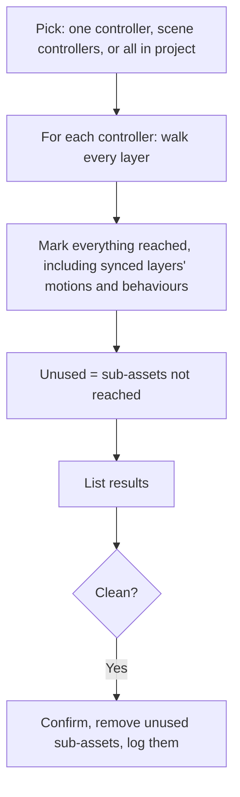

# Controller Cleaner

## 1. Where to find it

| Access | Location | Item |
| --- | --- | --- |
| Menu bar | RiryTools > Animator Tools > Controller Cleaner | |
| Main Menu | Animator Tools | Controller Cleaner |
| GUID Tools | Offered after Apply in the broken-reference window | |

## 2. Brief description

Finds and removes animator controller sub-assets that nothing in the controller's layers reaches any more.

## 3. What the tool can be used for

- Shrinking controllers that have built up leftover states, transitions, blend trees and behaviours while being edited.
- Clearing broken references that only live in those leftovers (GUID Tools offers it after a repair).

## 4. How the tool behaves

- Scans one controller, the controllers the open scenes use (any component that references one, with an override controller's base), or every controller in the project's Assets.
- Unused means no layer reaches it: state machines, states, transitions, behaviours and blend trees. A synced layer's own motions and behaviours count as used.
- Each row shows the unused count with a **Clean** button; **Clean all** cleans every listed controller.
- Ctrl+Z can't undo a clean, so it asks first and the log lists everything removed.

## 5. Flow chart

## 6. References

- Unity's `AnimatorController` sub-asset structure.
