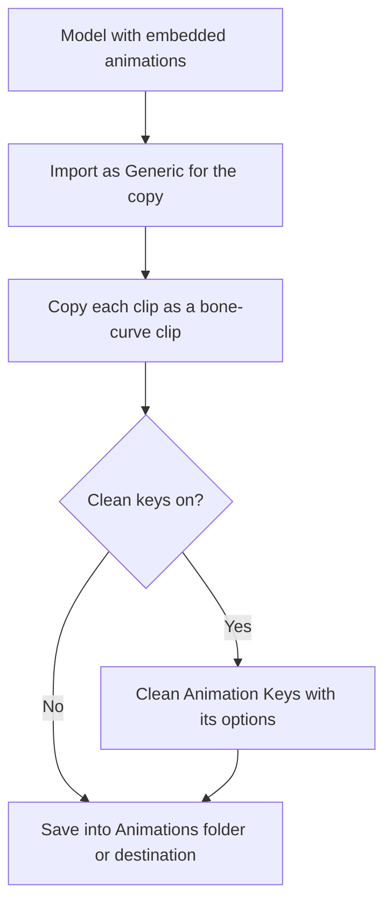

# Extract Animations

## 1. Brief description

Copies a model's animation clips into separate clips.

## 2. What the tool can be used for

- Getting editable animation clips out of an FBX or other model file that holds several animations.

## 3. How the tool behaves

- Opened from the Project window's right-click **RiryTools > Animator Tools > Extract Animations** (only for a model with embedded animations), from **Tools > RiryTools > Animator Tools**, or the Main Menu's Animator Tools tab.
- Copies the model's clips into an `Animations` folder (or a chosen destination) as plain bone-curve clips, importing the model as Generic for the copy.
- Can clean the copies with Clean Animation Keys, with its own options and whitelist.
- Can run automatically on import. Its settings are kept beside the model.

## 4. Flow chart

## 5. References

- Unity's model importer and `AnimationUtility`; Clean Animation Keys.
