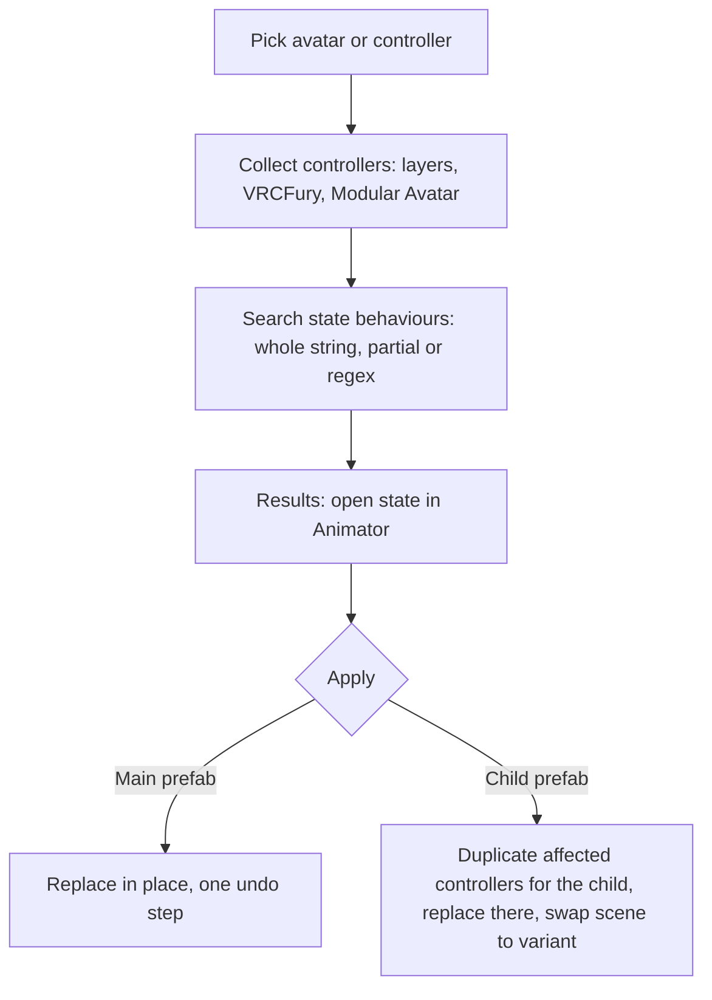

# Find and Replace

## 1. Where to find it

| Access | Location | Item |
| --- | --- | --- |
| Menu bar | RiryTools > Animator Tools > Find and Replace | |
| Main Menu | Animator Tools | Find and Replace |
| Right Click (hierarchy) | RiryTools > Animator Tools > Find and Replace | |
| Right Click (project) | RiryTools > Animator Tools > Find and Replace | |

## 2. Brief description

Finds strings in animator state behaviours and replaces them, whole or in part.

## 3. What the tool can be used for

- Renaming parameters, paths or other strings used by state behaviours across all of an avatar's controllers in one go.

## 4. How the tool behaves

- Searches (case-insensitive) an avatar's controllers (playable layers, VRCFury Full Controllers, Modular Avatar Merge Animators) or one animator controller.
- **Match** picks how: **Whole string** finds strings containing the search and replaces the whole string; **Partial** replaces only the searched text; **Regex** finds and replaces with a regular expression (`$1` and so on in Replace with). All ignore case. An invalid pattern is shown instead of searching.
- Apply is one undo step.
- Play Audio paths can be repathed to a scene object, and Parameter Driver names mapped to a controller parameter.
- Changes can be applied to the main prefab or to a child prefab, which duplicates the affected controllers for the child and swaps the scene to the variant.
- Each result opens its state in the Animator window.
- Needs the VRChat SDK.

## 5. Flow chart

## 6. References

- VRChat state behaviours (Play Audio, Parameter Driver); VRCFury and Modular Avatar components read by type name.
