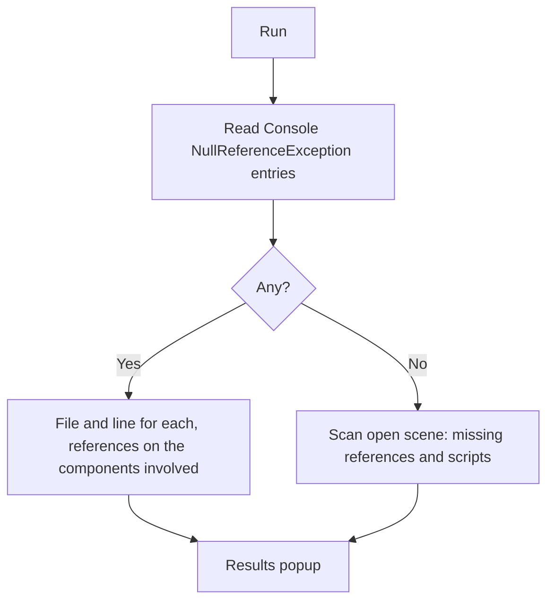

# Find Null References

## 1. Brief description

Shows where the Console's NullReferenceExceptions come from and the empty or missing references involved.

## 2. What the tool can be used for

- Tracking down the scene objects and script lines behind NullReferenceException errors.

## 3. How the tool behaves

- Reads the Console's NullReferenceException entries and shows the project or package file and line each was thrown at.
- Lists empty or missing references on the scene components those errors involved.
- If the log gives nothing, it scans the whole open scene for missing references and missing scripts.
- Runs once and shows the results in a popup.

## 4. Flow chart

## 5. References

- Unity's Console log entries and `SerializedObject` reference checks.
