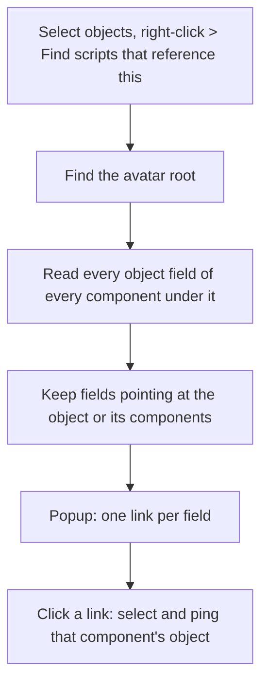

# Find scripts that reference this

## 1. Where to find it

| Access | Location | Item |
| --- | --- | --- |
| Right Click (hierarchy) | RiryTools > Find scripts that reference this | |

## 2. Brief description

Lists the components in the same avatar that reference the selected object, each as a link that selects that component's object.

## 3. What the tool can be used for

- Finding which constraints, joints, PhysBones, contacts or other components point at a bone or object before moving, renaming or deleting it.

## 4. How the tool behaves

- Run from the Hierarchy's right-click **RiryTools > Find scripts that reference this** with objects selected; it opens a popup.
- The search covers every component under the selected object's avatar root (the nearest parent with a VRC Avatar Descriptor, else with an Animator; the top of its hierarchy when it is in no avatar).
- A component is listed for each field that points at the selected object itself or one of its components; references to its children are not counted. A component's link to its own GameObject and Transforms' parent and child links are left out.
- Each result reads "Component on Object: field" (with the referenced component's type when the field points at a component). Clicking it selects that object in the Hierarchy and pings it.
- With several objects selected, each gets its own list. The results are worked out when the popup opens; nothing is changed.

## 5. Flow chart

## 6. References

- Unity's `SerializedObject` and `SerializedProperty` for reading the fields.
