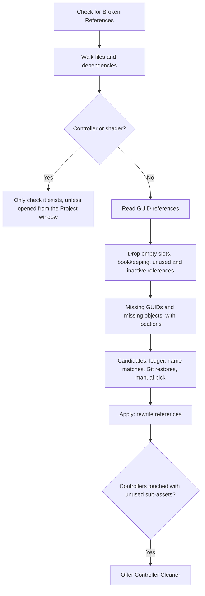

# GUID Tools

## 1. Where to find it

| Access | Location | Item |
| --- | --- | --- |
| Menu bar | RiryTools > GUID Tools | |
| Main Menu | General Tools > PopUp Tools | GUID Regenerator, GUID Repair, GUID Broken Reference Checker, Prefab Cleaner |
| Main Menu | Debug Tools | Delete GUID Reference Cache |
| Right Click (project) | RiryTools > Regenerate GUID | |
| Right Click (project) | RiryTools > Repair Missing GUID References | |
| Right Click (project) | RiryTools > Prefab Cleaner | |
| Prompt | When an opened scene or prefab points at missing assets | |

## 2. Brief description

Regenerates asset GUIDs without breaking references, and repairs references to assets that no longer exist.

## 3. What the tool can be used for

- Giving copied assets their own GUIDs (for example after copying a package folder) so they stop being treated as the original.
- Fixing references broken by deleted, replaced or re-imported assets.

## 4. How the tool behaves

- **Regenerate GUID** gives selected assets (and folders' contents) new GUIDs and rewrites every reference to them; folder GUIDs never change. Replaced GUIDs go into a permanent ledger in ProjectSettings, read with its Git history.
- **Check for Broken References** scans the open scenes and the files they use. The scan stops at animator controllers and shaders, which are only checked for being present; the Project window's **Repair Missing GUID References** also opens them.
- Not listed: empty slots, prefab bookkeeping, references in a controller's unused sub-assets, material texture slots the shader doesn't have, references outside objects that hold a missing reference when loaded, and references from a file to its own missing parts.
- Each missing GUID offers candidates (redirects, name matches, Git restores) or a manual pick. Each place it sits shows the object and field holding it; clicking selects the object.
- From the Main Menu's PopUp Tools, **GUID Regenerator** and **GUID Repair** open a popup listing the assets and folders to run on, filled from the Project window's selection when opened; entries can be added and removed before running.
- A reference can be ignored (kept out of the list and the save check). **Prefab Cleaner** removes prefab overrides whose target or property no longer exists, after asking. **Call material cleaner** opens Material Cleaner. The Project window's **RiryTools > Prefab Cleaner** does the same on the selected scenes and prefabs, and those in selected folders. From the Main Menu's PopUp Tools it opens a popup whose Target is Scene (the open scenes and the prefab in Prefab Mode), Project (the Project window's selection) or Prefab (one prefab asset), starting from the selection.
- After Apply, Controller Cleaner is offered on controllers the repair touched.
- When an opened scene or prefab points at missing assets, it offers Check for Broken References; saving such a file is guarded.

## 5. Flow chart

## 6. References

- Unity's text serialization (YAML) and `.meta` files, Git history for restores, Unity's `PrefabUtility` property modifications.
