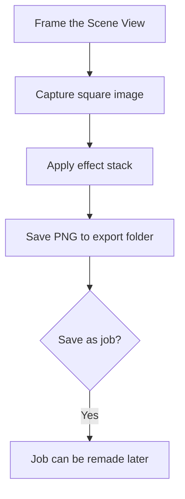

# IconCap

## 1. Brief description

Captures square PNG icons from the Scene View.

## 2. What the tool can be used for

- Making menu icons (for example expression menu icons) from objects in the scene.

## 3. How the tool behaves

- Captures a square image from the Scene View, runs it through an effect stack and saves it as a PNG to an export folder.
- Captures can be saved as jobs and remade later.
- Opens in its own window from the Main Menu's Tools tab.

## 4. Flow chart

## 5. References

- Unity's Scene View camera rendering.
