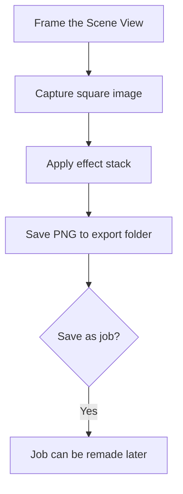

# IconCap

## 1. Where to find it

| Access | Location | Item |
| --- | --- | --- |
| Menu bar | RiryTools > General Tools > PopUp Tools > IconCap | |
| Main Menu | General Tools > PopUp Tools | IconCap |

## 2. Brief description

Captures square PNG icons from the Scene View.

## 3. What the tool can be used for

- Making menu icons (for example expression menu icons) from objects in the scene.

## 4. How the tool behaves

- Captures a square image from the Scene View, runs it through an effect stack and saves it as a PNG to an export folder.
- Captures can be saved as jobs and remade later: **Jobs** shows the **Current job** (this session's captures, with **Save job**) and **Saved jobs**.
- Capture options are in the **Camera** menu. Alpha cutout uses each material's own alpha-test settings.
- Opens in its own window from the Main Menu's General Tools > PopUp Tools sub-tab.

## 5. Flow chart

## 6. References

- The owner's IconCap feature list (the specification) and layout mockup.
- Unity's Scene View camera rendering.
