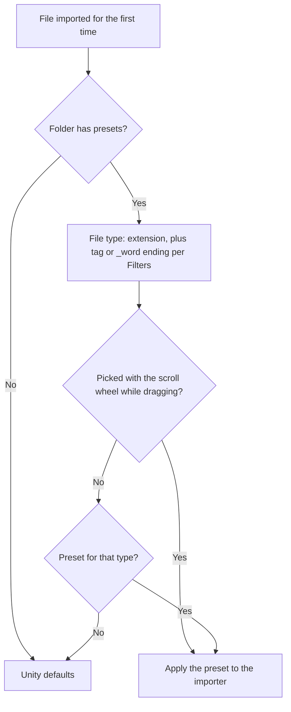

# Import Presets

## 1. Where to find it

| Access | Location | Item |
| --- | --- | --- |
| Menu bar | RiryTools > General Tools > Import Presets > Set Folder Import Presets / Save Import Preset / Open Import Preset Library | |
| Main Menu | General Tools > Import Presets | Set Folder Import Presets, Save Import Preset, Open Import Preset Library |
| Right Click (project) | RiryTools > General Tools > Import Presets > Set Folder Import Presets | |
| Right Click (project) | RiryTools > General Tools > Import Presets > Save Import Preset | |

## 2. Brief description

Assigns import presets to folders by file type and applies them to newly imported files.

## 3. What the tool can be used for

- Making every new texture, model or Blender file in a folder import with the settings you want, without touching files you already set up by hand.

## 4. How the tool behaves

- **Save Import Preset** saves a preset from an asset's importer into a shared library in `Documents/RiryTools/ImportPresets`, grouped into configurations.
- **Set Folder Import Presets** picks a preset per file type in a folder. File types are told apart by extension, and, as the **Filters** choose, by tags in the file name (PBR map names by default, editable) and `_word` name endings.
- A folder's presets apply only to files imported for the first time in that folder; reimports never change settings.
- While files from outside Unity are dragged over a Project folder that has presets, a box under the folder shows the preset each file will get. When a file could get more than one, the scroll wheel cycles them, and the one shown is used when the file is imported (within a minute of the drag).
- Better FBX can export Blender files through Blender.

## 5. Flow chart

## 6. References

- Unity's Preset system; Substance Painter's PBR map names for the default tags; Blender for Better FBX.
