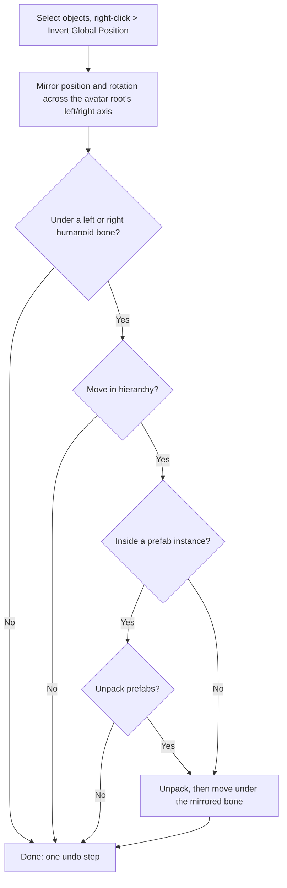

# Invert Global Position

## 1. Where to find it

| Access | Location | Item |
| --- | --- | --- |
| Right Click (hierarchy) | RiryTools > Invert Global Position | |

## 2. Brief description

Moves the selected objects to the other side of their avatar, with their rotation mirrored to match, and can move them under the bone on that side.

## 3. What the tool can be used for

- Moving a prop from one hand to the other: a pen in the right hand ends up in the same place relative to the left hand.
- Mirroring an accessory placed on one side (an ear, a shoulder, a leg) onto the other.

## 4. How the tool behaves

- Run from the Hierarchy's right-click **RiryTools > Invert Global Position** with objects inside an avatar selected; it has no window.
- The avatar is the nearest parent with a VRC Avatar Descriptor, or with an Animator if there is none. Each object's global position is mirrored across the avatar root's left/right axis, through the root's position, and its rotation is mirrored the same way. Scale is left alone.
- The avatar root itself, and objects with no avatar above them, are left out.
- On a humanoid avatar, an object under a left or right bone (its nearest such parent) is then offered the bone on the other side: **Move in hierarchy?** asks each time, listing each object and its new bone. Yes moves them, keeping their global position, rotation and scale.
- An object inside a prefab instance is only unpacked after the **Unpack prefabs?** warning, as in Attach To; Skip these leaves it mirrored where it is.
- The whole action is one undo step.

## 5. Flow chart

## 6. References

- Unity's `HumanBodyBones` and `Animator.GetBoneTransform` for the mirrored bone.
