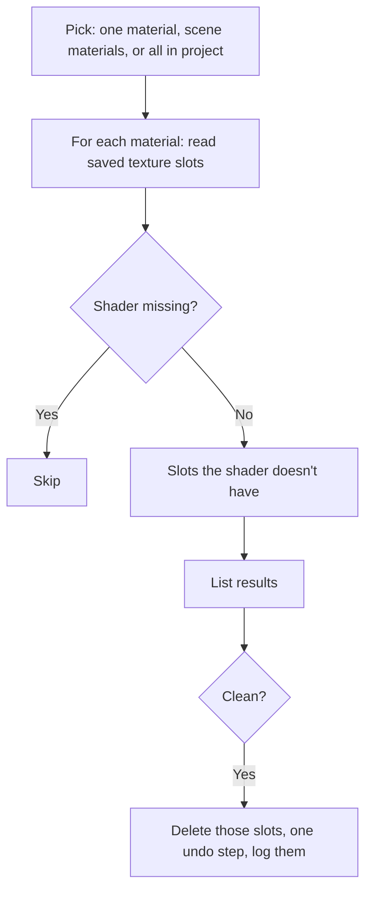

# Material Cleaner

## 1. Brief description

Removes texture slots a material's current shader doesn't have.

## 2. What the tool can be used for

- Clearing texture references left in a material from a shader it used before.

## 3. How the tool behaves

- Scans one material, the materials the open scenes use (any component that references one), or every `.mat` in the project's Assets. Materials inside models or packages are left out.
- A material whose shader is missing is skipped.
- Each row shows the count with a **Clean** button; **Clean all** cleans every listed material.
- Clean removes the texture slots, and the textures they reference, that the shader doesn't have. Each Clean is one undo step, and the log lists what was removed.
- Opened from the Main Menu's Tools tab.

## 4. Flow chart

## 5. References

- Unity's material serialization (`m_SavedProperties.m_TexEnvs`).
