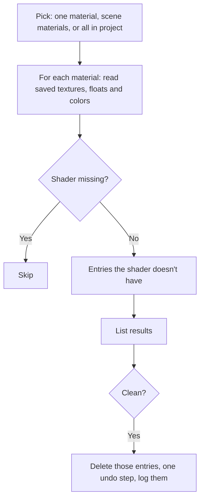

# Material Cleaner

## 1. Where to find it

| Access | Location | Item |
| --- | --- | --- |
| Menu bar | Tools > RiryTools > Utilities | Material Cleaner |
| Main Menu | General Tools > PopUp Tools | Material Cleaner |
| Right Click (project) | RiryTools > Material Cleaner | the selected material fills the Material field |
| Broken References window | Call material cleaner | |

## 2. Brief description

Removes texture, float and color entries a material's current shader doesn't have.

## 3. What the tool can be used for

- Clearing texture references and settings left in a material from a shader it used before.

## 4. How the tool behaves

- Scans one material, the materials the open scenes use (any component that references one), or every `.mat` in the project's Assets. Materials inside models or packages are left out.
- A material whose shader is missing is skipped.
- Each row shows the count with a **Clean** button; **Clean all** cleans every listed material.
- Clean removes the texture slots (and the textures they reference), floats and colors that the shader doesn't have. Each Clean is one undo step, and the log lists what was removed.
- Opened from **Tools > RiryTools > Utilities > Material Cleaner** or the Main Menu's General Tools > PopUp Tools sub-tab.

## 5. Flow chart

## 6. References

- Unity's material serialization (`m_SavedProperties.m_TexEnvs`, `m_Floats`, `m_Colors`).
