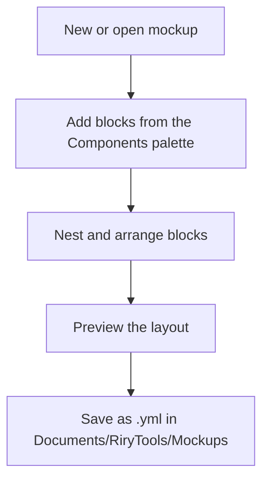

# Menu Mockup

## 1. Where to find it

| Access | Location | Item |
| --- | --- | --- |
| Menu bar | RiryTools > Menu Mockup | |

## 2. Brief description

Lays out an example editor window from blocks.

## 3. What the tool can be used for

- Sketching how a tool window should look before it is built.

## 4. How the tool behaves

- Every component is a block; blocks nest and lay out like flexbox.
- Blocks are added from a Components palette. A **Tabs** block holds its own blocks per tab, styled like the Main Menu's tabs.
- Mockups are saved as `.yml` files in `Documents/RiryTools/Mockups`; nothing is compiled.

## 5. Flow chart

## 6. References

- Flexbox layout rules.
