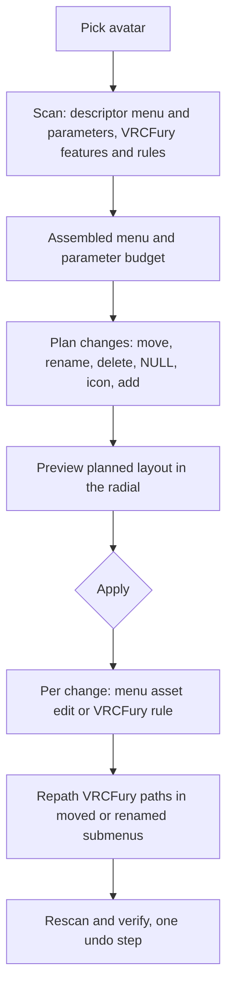

# Menu Tool

## 1. Where to find it

| Access | Location | Item |
| --- | --- | --- |
| Menu bar | RiryTools > Menu Tool | |
| Main Menu | Menu Tool | Parameter budget, Menu manager |

## 2. Brief description

Shows an avatar's assembled expression menu and parameters, traced to their sources, and plans changes to the menu.

## 3. What the tool can be used for

- Seeing the menu the avatar will have once VRCFury has built it, and where each control comes from.
- Checking the synced parameter budget, with and without VRCFury's compression.
- Moving, renaming, deleting and adding menu items, and assigning icons, from one place.

## 4. How the tool behaves

- Traces expression menu controls and parameters to their sources: the avatar descriptor and VRCFury (Modular Avatar is not read for now). VRCFury's menu rules (Move, Reorder, Set Icon, SPS, Security Lock, Override Menu Settings) are applied as VRCFury applies them.
- **Parameter budget** compares synced parameter cost with and without VRCFury's Parameter Compressor, estimated or exact (two isolated test builds).
- **Menu manager** previews the assembled radial menu in Edit Mode with Gesture Manager's radial, and a list of every entry.
- Planned changes: moves (drag, or **Move to…**), Destructive Move, new menus and controls, **Assign Menu Icon**, **Rename Menu Entry** (radial right-click or triple-click in the list), **Delete Menu Entry** (radial right-click or Delete key) and **Move to… > <NULL>** (a VRCFury Move Menu Item to a blank path). Nothing changes until Apply; the plan is saved per avatar.
- **Apply** makes each change through the system owning the control, as one undo step: menu assets are edited in place, VRCFury items get VRCFury rules, and VRCFury paths inside a moved or renamed submenu follow it.
- The radial's parameter writes and submenu can be replayed when Gesture Manager starts Play Mode.
- **Rescan** rebuilds the scan, preview and radial.

## 5. Flow chart

## 6. References

- The owner's Menu Tool specification (`Menu-Tool.md`).
- VRCFury (reference only): the Parameter Compressor (`Editor-Avatars/Service/Compressor/ParameterCompressorService.cs`), followed for the compressed budget; its menu path and Full Controller rewrite rules; Move / Reorder Menu Item and Set Icon behaviour.
- Gesture Manager 3.9.9: its radial menu, called by reflection, for the preview.
- Modular Avatar: menu installers and items, read by type name (currently off).
