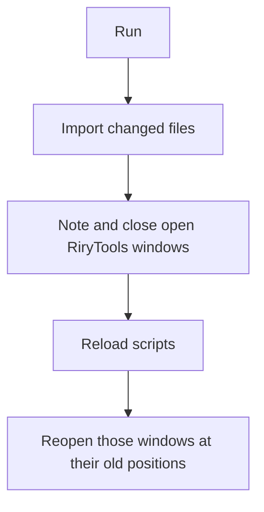

# Refresh Scripts

## 1. Where to find it

| Access | Location | Item |
| --- | --- | --- |
| Menu bar | RiryTools > Refresh Scripts | |
| Main Menu | Debug Tools | Refresh Scripts |

## 2. Brief description

Reloads all scripts and reopens the open RiryTools windows.

## 3. What the tool can be used for

- Seeing script and UI changes without restarting Unity.

## 4. How the tool behaves

- Imports changed files, closes the open RiryTools windows, reloads all scripts, then reopens those windows at their old positions with fresh state.

## 5. Flow chart

## 6. References

- Unity's script compilation and domain reload.
