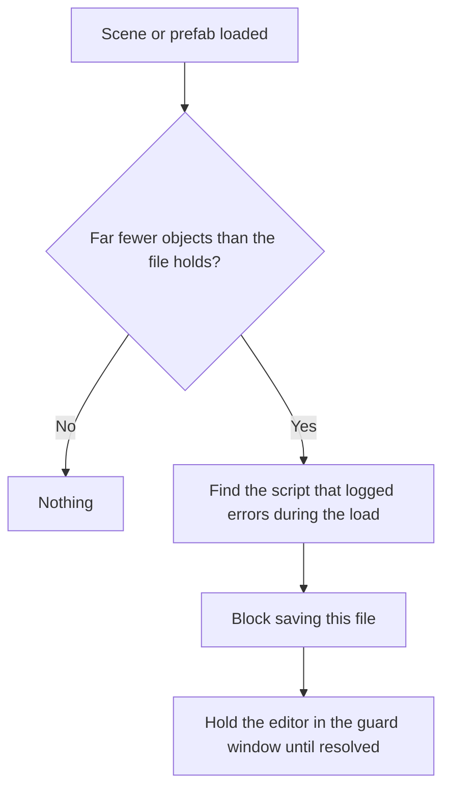

# Script Load Guard

## 1. Brief description

Stops a scene or prefab that loaded with far fewer objects than its file holds from being saved.

## 2. What the tool can be used for

- Protecting a scene or prefab from being overwritten when a broken package script made it load empty.

## 3. How the tool behaves

- Detects a scene or prefab that loaded with far fewer objects than its file holds.
- Names the script that logged errors during the load.
- Blocks saving it, so the good file is not overwritten, and holds the editor in a window until it is resolved.
- Can be turned off from the menu or the Main Menu's Tools tab.

## 4. Flow chart

## 5. References

- Unity's scene loading and save callbacks.
