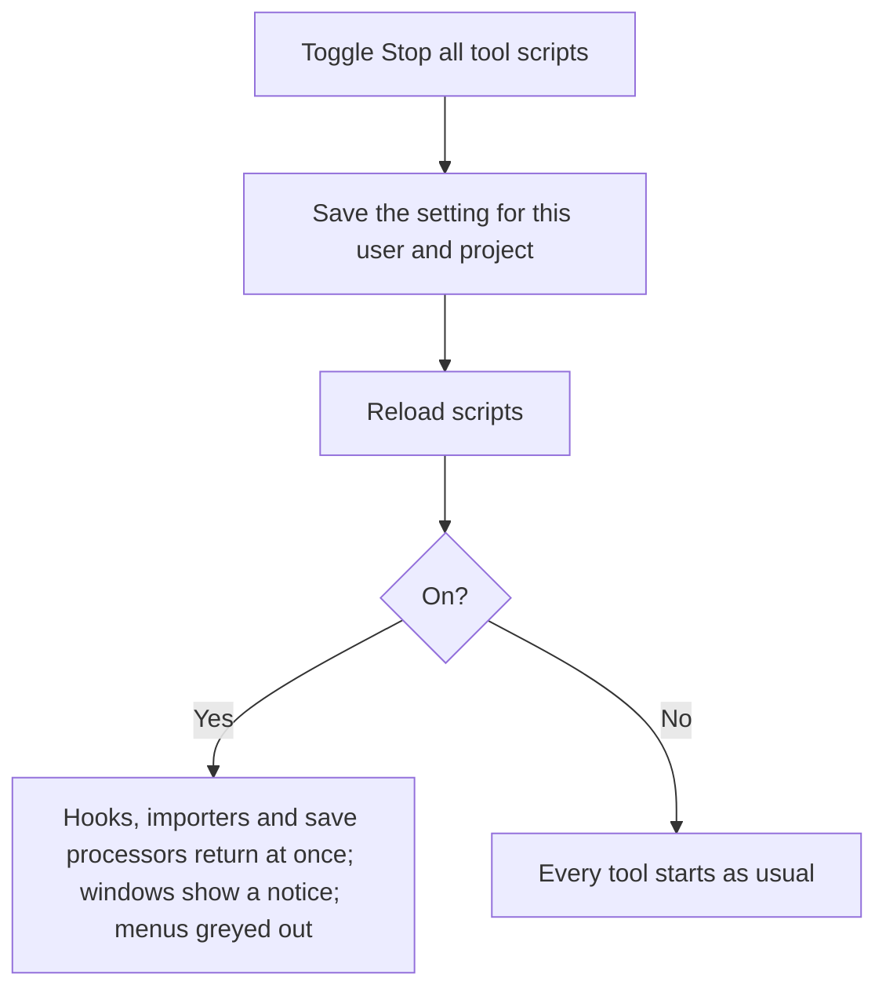

# Stop all tool scripts

## 1. Where to find it

| Access | Location | Item |
| --- | --- | --- |
| Menu bar | RiryTools > Debug Tools > Stop all tool scripts (toggle) | |
| Main Menu | Debug Tools | Stop all tool scripts (toggle) |

## 2. Brief description

An emergency switch that keeps every RiryTools script from running.

## 3. What the tool can be used for

- Stopping RiryTools when one of its scripts misbehaves, without removing the package.

## 4. How the tool behaves

- While on, nothing starts on load: each tool's load hooks return at once, importers and save processors pass files through untouched, and every RiryTools window shows only a notice.
- Every menu entry is greyed out except this toggle, the Main Menu and Documentation.
- Saved for this user in this project, so it stays on through script reloads and restarts until turned off.
- Turning it on or off reloads scripts, so every tool stops or starts cleanly.

## 5. Flow chart

## 6. References

- Unity's `EditorUserSettings` and `EditorUtility.RequestScriptReload`.
