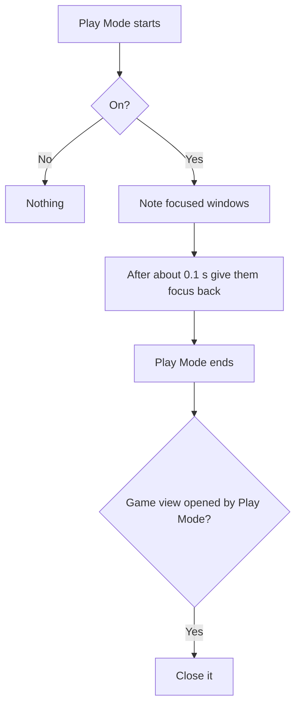

# Stop Auto Game

## 1. Where to find it

| Access | Location | Item |
| --- | --- | --- |
| Menu bar | RiryTools > Stop Auto Game (toggle) | |
| Main Menu | Tools > General | Stop Auto Game (toggle) |

## 2. Brief description

Keeps entering Play Mode from switching focus to the Game view.

## 3. What the tool can be used for

- Staying in the Scene view or another window when entering Play Mode.

## 4. How the tool behaves

- On by default, per user, for every project on the computer.
- About a tenth of a second after Play Mode starts, the windows that had focus get it back from the Game view.
- If Play Mode opened a Game view because the layout had none, it is closed when Play Mode ends, unless it was one of the windows that had focus.

## 5. Flow chart

## 6. References

- Unity's `EditorApplication.playModeStateChanged`.
